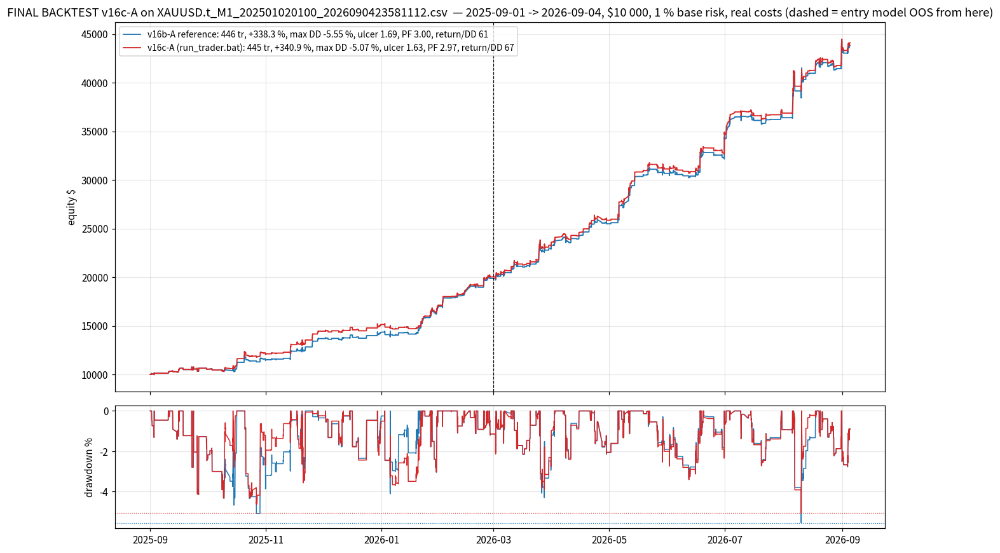

# FINAL BACKTEST — v16c-A (less drawdown: a smaller max drawdown % at the same profitability) on `XAUUSD.t_M1_202501020100_2026090423581112.csv`

*Generated by `backtest_v16c_final.py` on 2026-10-12 17:36 UTC.  Trader strings read from `run_trader.bat`; simulator `lubot/portfolio_sim.py`; selection streams `study_results/sel_v16_*.pkl` (the v16 top-3 recording of the scanner over this CSV, incl. M20).*

## Setup

- **Data**: 359,813 M1 bars, 2025-09-01 01:00 -> 2026-09-04 23:58 (the year used by every v10-v16c study; the CSV starts 2025-01-02 and the entry models were trained before the backtest window; the entry model is out-of-sample from 2026-03-01).
- **Account**: $10 000 start, **1.0 % base risk** per plan sized on equity, commission 7 $/lot round-turn, spread from the CSV, SL slippage 0.10 / market 0.05, daily loss limit 4.5 % -> flat until next server day, total loss 9 % -> halt.
- **Trader** (`--trader`): `tp_levels=0.6|1.2|2.4|4.8,tp_fracs=1|1|1|1,ladder_fallback=merge,dedupe_cross_tf=false,keep_replaced_bars=1,keep_replaced_tfs=M10|M15|M20|M30|H1,regime_metric=adr_ratio,regime_threshold=1.0,regime_short=5,regime_long=20,range_tp_levels=0.5|1.0|1.5|2.5,range_tp_fracs=1|1|1|1,range_sl_after_leg=0|0.3|x|x,mart_mode=mult,mart_mult=1.5,mart_max_steps=3,mart_max_risk_pct=3,mart_scope=tf,mart_tfs=M10|M15|M20|M30|H1,mart_sides=buy,mart_ungated_scale=0.5,confluence_memory_min=240,confluent_risk_scale=1.25,plain_risk_scale=0.9,tf_risk_scale=M20:0.4,min_fill_age_min=2,regime_side_scale=range:sell:0.5,dd_throttle_pct=3.5,dd_throttle_scale=0.5,dd_throttle_tfs=M15|M20|M30|H1`
- **Trade filter**: `M5:max_cost_r=0.08;min_quality=0.55;sessions=asia|london|preny|ny|lclose/M10:min_quality=0.57/M15:min_quality=0.60/M30|H1:min_quality=0.57/M20:min_quality=0.99`
- **Confluence filter**: `M5:max_cost_r=0.08;min_quality=0.55;sessions=asia|london|preny|ny|lclose/M10:min_quality=0.50/M15:min_quality=0.60/M30|H1:min_quality=0.57/M20:min_quality=0.63`
- **Reference**: the same strings with every v16c key removed = v16b-A (reproduces FINAL_BACKTEST_V16B: 446 tr / +338.31 % / DD -5.55).
- **Reproducibility**: result IDENTICAL to the v16c study json `DDT3.5_x0.5_htf.json` (445 tr / +340.92 % / DD -5.07 / PF 2.967).

## Result — full year

**v16c-A: max drawdown -5.07 % (v16b-A -5.55, +0.48 pt = 9 % less), max DD -2,091 $ (v16b-A -2,257), ulcer 1.628 (v16b-A 1.691), OOS max DD -5.07 % (v16b-A -5.55); net +34,092 $ (v16b-A +33,831, +0.8 %), +340.92 % ($10 000 -> $44,092), profit factor 2.967 (v16b-A 2.999), return / max DD 67.2 (v16b-A 61.0), 445 trades (v16b-A 446), win rate 75.5 % (v16b-A 75.8), stop-outs 24.0 % (v16b-A 23.8), gross $ lost -17,329 (v16b-A -16,921), worst day -2.25 % (v16b-A -2.34), 13/13 months positive, OOS net +24,063 $ (v16b-A +23,958), OOS PF 3.10 (v16b-A 3.12).**  Scorecard (v16c_common.judge16c): less drawdown True, profit held True, loss profile held True, OOS held True -> score 4/4.

| metric                                   |   v16b-A reference |   v16c-A (shipped) |
|:-----------------------------------------|-------------------:|-------------------:|
| trades                                   |           446      |           445      |
| net profit $                             |         33831      |         34092      |
| return %                                 |           338.31   |           340.92   |
| end balance $                            |         43831      |         44092      |
| MAX DRAWDOWN %                           |            -5.55   |            -5.07   |
| max drawdown $                           |         -2257      |         -2091      |
| 2nd deepest DD %                         |            -5.09   |            -4.65   |
| 3rd deepest DD %                         |            -4.68   |            -4.32   |
| ulcer index                              |             1.691  |             1.628  |
| return / max DD                          |            61      |            67.2    |
| OOS max DD %                             |            -5.55   |            -5.07   |
| profit factor                            |             2.999  |             2.967  |
| win %                                    |            75.8    |            75.5    |
| stop-outs %                              |            23.8    |            24      |
| gross $ lost                             |        -16921      |        -17329      |
| avg loss $                               |          -156.7    |          -159      |
| gross $ won                              |         50753      |         51421      |
| total R                                  |           138.55   |           144.44   |
| avg R / trade                            |             0.3106 |             0.3246 |
| expectancy $ / trade                     |            75.85   |            76.61   |
| worst trade % of equity                  |            -1.3    |            -1.39   |
| worst day % of equity                    |            -2.34   |            -2.25   |
| negative days                            |            58      |            57      |
| max consecutive losses                   |             3      |             3      |
| daily Sharpe                             |             5.98   |             6.03   |
| max risk % of equity                     |             2.81   |             2.79   |
| avg risk $                               |           208      |           209      |
| commission $                             |           632      |           638      |
| swap $                                   |          -234      |          -236      |
| avg hold (min)                           |           227      |           233      |
| months positive                          |            13      |            13      |
| worst month $                            |           457      |           457      |
| IS R (Sep25-Feb26)                       |            68.77   |            74.56   |
| IS PF                                    |             2.75   |             2.717  |
| OOS trades (Mar-Sep26)                   |           232      |           232      |
| OOS R                                    |            69.77   |            69.88   |
| OOS PF                                   |             3.124  |             3.095  |
| OOS win %                                |            78.9    |            78.9    |
| OOS stop-outs %                          |            21.1    |            21.1    |
| OOS net $                                |         23958      |         24063      |
| confluent trades                         |           223      |           222      |
| M20 trades                               |            20      |            19      |
| stepped up (martingale)                  |            37      |            39      |
| stepped down                             |            69      |            68      |
| plans THROTTLED by the drawdown lever    |             0      |            96      |
| plans skipped by the drawdown lever      |             0      |             0      |
| minutes spent > threshold under the peak |             0      |            22      |
| plans scaled by the day soft cap         |             0      |             0      |
| plans skipped by the day soft cap        |             0      |             0      |
| fast fills cancelled                     |            22      |            22      |
| pending orders placed                    |          4339      |          4342      |
| daily-loss halts                         |             0      |             0      |

## The drawdown episodes (five deepest of each equity path)

| trader   | start            | trough           | end              |   depth_% |   days |
|:---------|:-----------------|:-----------------|:-----------------|----------:|-------:|
| v16b-A   | 2026-08-06 05:45 | 2026-08-10 04:47 | 2026-08-10 08:47 |     -5.55 |    4.1 |
| v16b-A   | 2025-10-21 01:04 | 2025-10-27 01:08 | 2025-11-13 23:21 |     -5.09 |   23.9 |
| v16b-A   | 2025-09-23 22:44 | 2025-10-15 05:00 | 2025-10-16 17:01 |     -4.68 |   22.8 |
| v16b-A   | 2026-03-25 15:20 | 2026-03-27 19:22 | 2026-04-02 07:26 |     -4.3  |    7.7 |
| v16b-A   | 2026-01-02 18:49 | 2026-01-05 12:50 | 2026-01-05 14:50 |     -4.11 |    2.8 |
| v16c-A   | 2026-08-06 05:45 | 2026-08-10 04:47 | 2026-08-10 10:47 |     -5.07 |    4.2 |
| v16c-A   | 2025-10-21 01:04 | 2025-10-27 03:08 | 2025-11-13 22:21 |     -4.65 |   23.9 |
| v16c-A   | 2025-09-23 22:44 | 2025-10-09 16:56 | 2025-10-14 16:59 |     -4.32 |   20.8 |
| v16c-A   | 2026-03-25 15:20 | 2026-03-27 19:22 | 2026-04-02 04:26 |     -3.9  |    7.5 |
| v16c-A   | 2026-01-02 18:49 | 2026-01-08 07:53 | 2026-01-21 20:07 |     -3.69 |   19.1 |

## Where the drawdown reduction comes from

| slice                                           |   trades |   win % |   stop % |   net $ |   $ lost |   avg R |   avg risk $ |   OOS trades |   OOS net $ |
|:------------------------------------------------|---------:|--------:|---------:|--------:|---------:|--------:|-------------:|-------------:|------------:|
| v16b-A trades NOT taken by v16c-A               |        2 |    50   |     50   |     122 |      -36 |   0.734 |           50 |            0 |           0 |
| trades NEW in v16c-A                            |        1 |   100   |      0   |     193 |        0 |   3.334 |           58 |            0 |           0 |
| common keys at a DIFFERENT size (v16c-A result) |      165 |    80   |     20   |   16074 |    -6835 |   0.404 |          237 |           81 |       12443 |
| the same keys in v16b-A                         |      165 |    81.2 |     18.8 |   15885 |    -6392 |   0.38  |          235 |           81 |       12339 |
| common keys at the same size                    |      279 |    72.8 |     26.5 |   17825 |   -10494 |   0.267 |          193 |          151 |       11620 |

| trader   | population                    |   trades |   win % |   stop % |   net $ |   $ lost |   avg R |   avg risk $ |   OOS trades |   OOS net $ |
|:---------|:------------------------------|---------:|--------:|---------:|--------:|---------:|--------:|-------------:|-------------:|------------:|
| v16c-A   | all                           |      445 |    75.5 |     24   |   34092 |   -17329 |   0.325 |          209 |          232 |       24063 |
| v16c-A   | M5|M10                        |      324 |    74.7 |     25   |   22784 |   -12672 |   0.287 |          203 |          163 |       15162 |
| v16c-A   | M15+                          |      121 |    77.7 |     21.5 |   11308 |    -4657 |   0.425 |          224 |           69 |        8901 |
| v16c-A   | buys                          |      293 |    80.9 |     18.4 |   28497 |   -11064 |   0.39  |          246 |          161 |       19809 |
| v16c-A   | sells                         |      152 |    65.1 |     34.9 |    5595 |    -6265 |   0.198 |          138 |           71 |        4254 |
| v16c-A   | confluent                     |      222 |    79.3 |     20.3 |   23906 |    -7678 |   0.375 |          243 |          111 |       17724 |
| v16c-A   | plain                         |      223 |    71.7 |     27.8 |   10186 |    -9650 |   0.275 |          175 |          121 |        6339 |
| v16c-A   | THROTTLED (dd_scale < 1)      |       15 |    86.7 |     13.3 |     656 |      -96 |   0.673 |           96 |            3 |         189 |
| v16c-A   | placed > 3.5 % under the peak |       46 |    80.4 |     19.6 |    2781 |     -706 |   0.461 |          122 |            7 |        1008 |
| v16b-A   | all                           |      446 |    75.8 |     23.8 |   33831 |   -16921 |   0.311 |          208 |          232 |       23958 |
| v16b-A   | M5|M10                        |      323 |    74.6 |     25.1 |   21850 |   -12485 |   0.273 |          200 |          163 |       14872 |
| v16b-A   | M15+                          |      123 |    78.9 |     20.3 |   11981 |    -4436 |   0.409 |          229 |           69 |        9087 |
| v16b-A   | buys                          |      294 |    81   |     18.4 |   28483 |   -10803 |   0.389 |          245 |          161 |       19826 |
| v16b-A   | sells                         |      152 |    65.8 |     34.2 |    5349 |    -6118 |   0.159 |          137 |           71 |        4133 |
| v16b-A   | confluent                     |      223 |    79.8 |     19.7 |   24005 |    -7445 |   0.37  |          244 |          111 |       17714 |
| v16b-A   | plain                         |      223 |    71.7 |     27.8 |    9826 |    -9476 |   0.252 |          172 |          121 |        6244 |
| v16b-A   | THROTTLED (dd_scale < 1)      |        0 |     0   |      0   |       0 |        0 |   0     |            0 |            0 |           0 |
| v16b-A   | placed > 3.5 % under the peak |       40 |    77.5 |     22.5 |    3297 |     -605 |   0.386 |          149 |            8 |        1512 |

## Month by month

| month   |   v16c-A trades |   v16c-A net $ |   v16c-A stop % |   v16c-A throttled |   v16b-A trades |   v16b-A net $ |   v16b-A stop % |
|:--------|----------------:|---------------:|----------------:|-------------------:|----------------:|---------------:|----------------:|
| 2025-09 |              22 |         456.91 |            31.8 |                  0 |              22 |         456.91 |            31.8 |
| 2025-10 |              42 |        1661.34 |            42.9 |                  4 |              42 |        1052.68 |            42.9 |
| 2025-11 |              35 |        2327.53 |            14.3 |                  0 |              35 |        2172.71 |            14.3 |
| 2025-12 |              29 |         686.03 |            34.5 |                  0 |              29 |         662.63 |            34.5 |
| 2026-01 |              50 |        1987.43 |            26   |                  8 |              51 |        2637.94 |            23.5 |
| 2026-02 |              35 |        2909.85 |            14.3 |                  0 |              35 |        2890.07 |            14.3 |
| 2026-03 |              42 |        3581.16 |            21.4 |                  1 |              42 |        3399.7  |            21.4 |
| 2026-04 |              39 |        2236.37 |            25.6 |                  0 |              39 |        2215.6  |            25.6 |
| 2026-05 |              31 |        5286.62 |            12.9 |                  0 |              31 |        5180.44 |            12.9 |
| 2026-06 |              35 |        3554.54 |            22.9 |                  0 |              35 |        3551.15 |            22.9 |
| 2026-07 |              37 |        2186.48 |            24.3 |                  0 |              37 |        2178.34 |            24.3 |
| 2026-08 |              44 |        6233.14 |            18.2 |                  2 |              44 |        6441.13 |            18.2 |
| 2026-09 |               4 |         984.63 |            25   |                  0 |               4 |         992    |            25   |

## By timeframe

| tf   |   v16c-A trades |   v16c-A win % |   v16c-A net $ |   v16c-A PF |   v16b-A trades |   v16b-A win % |   v16b-A net $ |   v16b-A PF |
|:-----|----------------:|---------------:|---------------:|------------:|----------------:|---------------:|---------------:|------------:|
| H1   |              14 |           78.6 |        1560.67 |        4.48 |              14 |           78.6 |        1621.04 |        4.86 |
| M10  |             161 |           77   |       12999    |        3.03 |             161 |           77   |       12620.4  |        3    |
| M15  |              50 |           82   |        5847.34 |        3.38 |              50 |           82   |        6280.47 |        3.67 |
| M20  |              19 |           78.9 |         949.64 |        4.84 |              20 |           85   |        1084.65 |        5.86 |
| M30  |              38 |           71.1 |        2950.69 |        2.96 |              39 |           71.8 |        2994.97 |        3.07 |
| M5   |             163 |           72.4 |        9784.74 |        2.56 |             162 |           72.2 |        9229.73 |        2.49 |

Exit outcomes: partial_be 203, sl 107, tp2 79, trail 56.  Range-managed trades: 228, confluent: 222, M20: 19, stepped up / down: 39 / 68.  Plans throttled by the drawdown lever 96, skipped 0; day soft cap scaled 0, skipped 0; fast fills cancelled 22.  Pending orders placed 4342, cancelled unfilled 3897.

OOS half (from 2026-03-01): 232 trades, net 24,063 $, PF 3.10, win 78.9 %, stop-outs 21.1 %, max DD -5.07 %.

## Five worst trades

| key         | side   | close_time          | regime   | confluent   |   dd_pct_at |   dd_scale |   risk_money |     net |   r_net | outcome   |
|:------------|:-------|:--------------------|:---------|:------------|------------:|-----------:|-------------:|--------:|--------:|:----------|
| M10#6007686 | buy    | 2026-09-04 15:30:00 | trend    | True        |        1.59 |          1 |       547.2  | -560.12 |   -1.02 | sl        |
| M10#6006718 | buy    | 2026-08-06 18:35:00 | trend    | True        |        1.52 |          1 |       509.6  | -517.93 |   -1.02 | sl        |
| M15#6003988 | buy    | 2026-07-15 05:18:00 | range    | False       |        0.12 |          1 |       495.69 | -517.4  |   -1.04 | sl        |
| M15#6003469 | buy    | 2026-06-18 11:45:00 | trend    | True        |        0.59 |          1 |       403.26 | -407.68 |   -1.01 | sl        |
| M15#6002884 | buy    | 2026-05-26 14:35:00 | range    | True        |        0.56 |          1 |       391.1  | -392.8  |   -1    | sl        |

## Files

`study_results/final_v16c/v16cA_summary.json` (all metrics + episodes), `v16cA_trades.csv` (every trade with `dd_pct_at` / `dd_scale` / `risk_scale` / legs), `v16cA_equity.csv` (balance + equity), `v16cA_monthly.csv`, `v16cA_by_tf.csv`, the same for `ref_*` (v16b-A), chart `charts/final_v16c_equity.png`.  Full study: `study_results/LESS_DD_V16C.md`.
