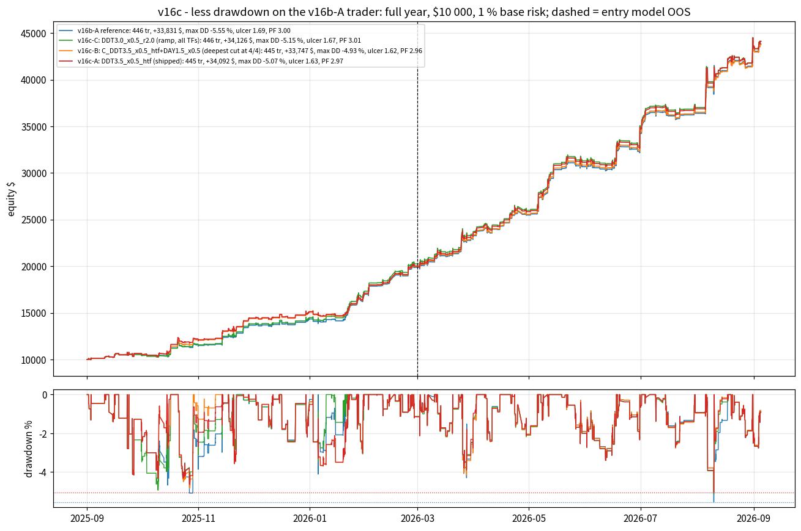
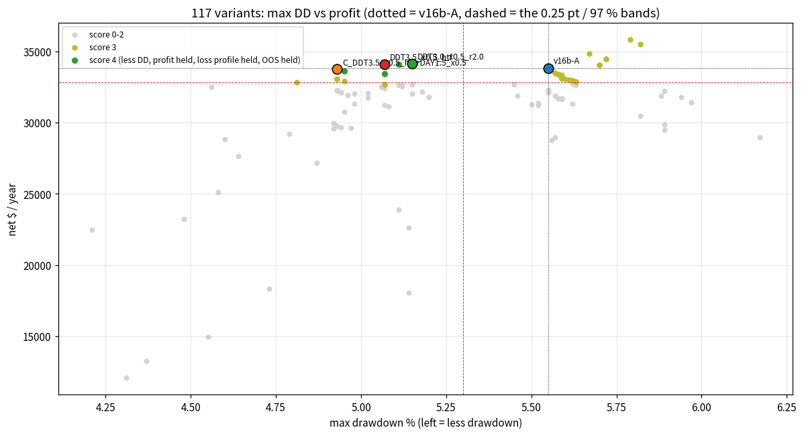
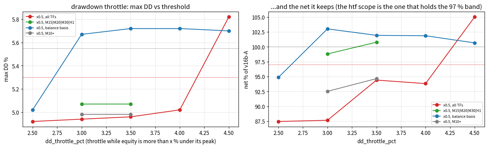
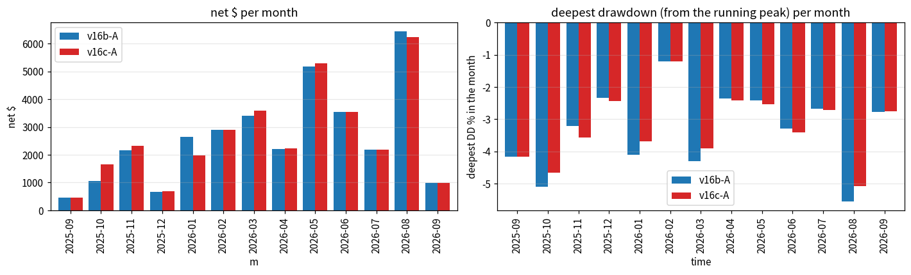

# REDUCE THE MAX DRAWDOWN PERCENTAGE WHILE MAINTAINING THE PROFITABILITY PERCENTAGE (v16c) — the v16b-A trader

*Generated by `make_v16c_report.py` on 2026-10-12 17:08 UTC from the result files in `study_results/` (nothing typed in).*

## 0. Answer

**v16c-A = v16b-A + `dd_throttle_pct=3.5,dd_throttle_scale=0.5,dd_throttle_tfs=M15|M20|M30|H1`** (shipped in `run_trader.bat`).  Full year Sep 2025 -> Sep 2026, $10 000, 1 % base risk, real costs (grid run `v16c_levers/DDT3.5_x0.5_htf.json` (final backtest pending)): **max drawdown -5.07 % (v16b-A -5.55, +0.48 pt = 9 % less), 2nd / 3rd deepest episodes -4.65 / -4.32 (-5.09 / -4.68), ulcer 1.628 (1.691), OOS max DD -5.07 (-5.55), return / max DD 67.2 (61.0) — with the profitability held: net +34,092 $ (+33,831, +0.8 %), +340.9 %, profit factor 2.967 (2.999), win 75.5 % (75.8), stop-outs 24.0 % (23.8), gross $ lost -17,329 (-16,921), worst day -2.25 % (-2.34), OOS net +24,063 $ (+23,958), OOS PF 3.10 (3.12), 13/13 months positive, 445 trades (446).**  Score 4/4 on the v16c judge; walk-forward: the drawdown is cut in BOTH halves with the net held in both; stress x6: pending.

The lever is decided BEFORE the order is placed and is live already (`trader.py`, tests `tests/test_trader_v16c.py`, `tests/test_bat_v16c.py`):
* **Equity-drawdown throttle on the higher timeframes** (`dd_throttle_pct=3.5,dd_throttle_scale=0.5,dd_throttle_tfs=M15|M20|M30|H1`): while the account equity (balance + floating P/L) is more than 3.5 % below its running peak, every NEW M15 / M20 / M30 / H1 plan is sized at half risk; M5 / M10 plans keep full size.  Nothing is closed or cancelled; the size comes back as soon as equity is within 3.5 % of the peak.  The peak is persisted in `trader_state.json` (`risk.peak_equity`, refreshed every loop) so a restart inside a drawdown keeps throttling.

## 1. Method

Same discipline as v10-v16b: the v16b-A trader exactly as shipped (strings frozen in `v16c_common.py` and cross-checked against the bat), replayed through the M1 portfolio simulator over the full year; parity of the reference reproduced first (446 tr / +33,831 $ / DD -5.55 = FINAL_BACKTEST_V16B).  **Interpretation**: *max drawdown percentage* = the max peak-to-trough fall of the EQUITY path (closed + floating, the number of every report); *profitability percentage* = return % (net $) AND profit factor AND OOS net.  **Judge (`v16c_common.judge16c`)**: *less_dd* = max DD better by >= 0.25 pt AND OOS max DD not worse AND ulcer <= ref (the whole path shallower, not one point); *hold_profit* = net >= 97 % of ref AND PF >= ref - 0.10 AND OOS net >= 97 %; *hold_loss* = stop % <= ref + 1 pt AND gross $ lost <= 105 % AND worst day >= ref - 0.25 pt (the v16b gains must not regress); *hold_oos* = OOS PF >= ref - 0.10 AND OOS stop % <= ref + 1 pt AND 13/13 months.  Score 0-4.  Steps: diagnosis of the drawdown episodes -> levers in the simulator (defaults byte-identical) -> grid of 117 variants -> walk-forward of the whole grid + stress x6 of 6 finalists -> port to the bat + live bot -> final backtest from the bat strings.

## 2. Diagnosis — what the drawdown of v16b-A is made of (`v16c_diag/DIAG.md`, 15 tables)

Five episodes within 1.5 pt of each other - a lever has to cut ALL of the top three, otherwise the max DD just moves to the next one.  The deepest (#1, Aug 2026) is a third FLOATING: three confluent buys open at the trough (3.7 % open risk) that all won afterwards; #2 and #3 (autumn 2025) are long, all-realised grinds of small losers.  The balance-path (closed trades only) DD is just -5.09 %: the floating part of open, eventually winning positions adds the last 0.5 pt.

|   ep | start               | trough              |   depth_% |   days |   realised_% |   floating_% |   open_at_trough |   open_risk_at_trough_% |   closed_n |   closed_sl |   closed_loss_$ |   avg risk % eq |
|-----:|:--------------------|:--------------------|----------:|-------:|-------------:|-------------:|-----------------:|------------------------:|-----------:|------------:|----------------:|----------------:|
|    1 | 2026-08-06 05:45:00 | 2026-08-10 04:47:00 |     -5.55 |    4.1 |        -3.8  |        -1.74 |                3 |                    3.72 |          5 |           3 |           -1048 |            1.12 |
|    2 | 2025-10-21 01:04:00 | 2025-10-27 01:08:00 |     -5.09 |   23.9 |        -5.09 |         0    |                0 |                    0    |         10 |           6 |            -543 |            0.62 |
|    3 | 2025-09-23 22:44:00 | 2025-10-15 05:00:00 |     -4.68 |   22.8 |        -4.68 |         0    |                0 |                    0    |         25 |          12 |           -1128 |            0.88 |
|    4 | 2026-03-25 15:20:00 | 2026-03-27 19:22:00 |     -4.3  |    7.7 |        -3.78 |        -0.52 |                2 |                    3.67 |          3 |           2 |            -396 |            0.98 |
|    5 | 2026-01-02 18:49:00 | 2026-01-05 12:50:00 |     -4.11 |    2.8 |        -2.46 |        -1.64 |                3 |                    2.98 |          0 |           0 |               0 |          nan    |

**Trades by the account's drawdown at the fill** - the trades taken while the account is under water EARN (they are the recovery), so a throttle costs recovery and can only win on DEPTH - and the deeper bands are small:

| dd_band   |   trades |   stop-outs |   stop % |   net $ |   $ lost |   risk $ |   avg risk % eq |
|:----------|---------:|------------:|---------:|--------:|---------:|---------:|----------------:|
| <-4       |        4 |           2 |     50   |    -110 |     -146 |      231 |            0.51 |
| -4..-3    |       25 |           9 |     36   |    1324 |     -752 |     4885 |            0.91 |
| -3..-2    |       57 |          14 |     24.6 |    2034 |    -1423 |     9211 |            0.75 |
| -2..-1    |       83 |          24 |     28.9 |     725 |    -4078 |    20148 |            0.96 |
| -1..0     |      148 |          42 |     28.4 |    8886 |    -7860 |    30831 |            0.91 |
| at peak   |      129 |          15 |     11.6 |   20971 |    -2663 |    27415 |            0.95 |

**After consecutive losses** - the next trades are fine (a streak throttle is not a lever):

|   prev_losses |   trades |   stop-outs |   stop % |   net $ |   $ lost |   risk $ |   avg risk % eq |
|--------------:|---------:|------------:|---------:|--------:|---------:|---------:|----------------:|
|             0 |      338 |          72 |     21.3 |   29026 |   -12241 |    74658 |            0.94 |
|             1 |       72 |          27 |     37.5 |    2987 |    -3489 |    11243 |            0.76 |
|             2 |       28 |           7 |     25   |     111 |    -1191 |     4852 |            0.87 |
|             3 |        8 |           0 |      0   |    1706 |        0 |     1968 |            1.12 |

**Risk per plan** - the big plans (confluent x1.25) stop out least and earn most; the small ones stop out most.  Sizing already follows quality - nothing to cut there:

| risk_band   |   trades |   stop-outs |   stop % |   net $ |   $ lost |   risk $ |   avg risk % eq |
|:------------|---------:|------------:|---------:|--------:|---------:|---------:|----------------:|
| (0.0, 0.5]  |      103 |          36 |     35   |    1116 |    -2835 |     8585 |            0.38 |
| (0.5, 0.9]  |      166 |          46 |     27.7 |    6340 |    -8430 |    32372 |            0.82 |
| (0.9, 1.1]  |        5 |           2 |     40   |     380 |     -222 |      722 |            1.02 |
| (1.1, 1.4]  |      150 |          22 |     14.7 |   20465 |    -5435 |    41207 |            1.22 |
| (1.4, 2.0]  |       18 |           0 |      0   |    3731 |        0 |     6811 |            1.82 |
| (2.0, 5.0]  |        4 |           0 |      0   |    1800 |        0 |     3023 |            2.41 |

**Concurrent same-side plans** - 1-2 open same-side plans WIN (a same-side cap halves the profit):

|   same_side_at_fill |   trades |   stop-outs |   stop % |   net $ |   $ lost |   risk $ |   avg risk % eq |
|--------------------:|---------:|------------:|---------:|--------:|---------:|---------:|----------------:|
|                   0 |      287 |          76 |     26.5 |   14908 |   -12425 |    55595 |            0.83 |
|                   1 |      114 |          22 |     19.3 |   10470 |    -2831 |    24295 |            1.04 |
|                   2 |       31 |           4 |     12.9 |    5693 |    -1018 |     9019 |            1.06 |
|                   3 |       14 |           4 |     28.6 |    2760 |     -648 |     3811 |            1.06 |

**Static estimate** (trade list re-walked with a sizing rule, before re-simulation; balance-path DD): only the 3.0-3.5 % x0.5-0.75 throttles cut >= 0.2 pt at >= 97 % net:

| variant       |   trades |   net $ |   OOS net $ |   bal_dd_% |    PF |   stop % |   $ lost |   DD pt gained |   net_%ref |   OOS_%ref |
|:--------------|---------:|--------:|------------:|-----------:|------:|---------:|---------:|---------------:|-----------:|-----------:|
| DDT_3.5_x0.25 |      446 |   32812 |       23480 |      -4.13 | 3.027 |     23.8 |   -16185 |           0.94 |       95.7 |       96.7 |
| DDT_3.0_x0.5  |      446 |   32771 |       23457 |      -4.15 | 3.017 |     23.8 |   -16250 |           0.92 |       95.6 |       96.6 |
| DDT_3.0_x0.6  |      446 |   33083 |       23628 |      -4.33 | 3.018 |     23.8 |   -16397 |           0.74 |       96.5 |       97.3 |
| DDT_3.5_x0.5  |      446 |   33608 |       23916 |      -4.45 | 3.028 |     23.8 |   -16572 |           0.62 |       98   |       98.5 |
| DAY_1.0_x0.5  |      446 |   33270 |       23434 |      -4.5  | 3.012 |     23.8 |   -16532 |           0.57 |       97   |       96.5 |
| DDT_3.5_x0.6  |      446 |   33630 |       23928 |      -4.57 | 3.019 |     23.8 |   -16656 |           0.5  |       98.1 |       98.5 |
| DDT_3.0_x0.75 |      446 |   33431 |       23819 |      -4.61 | 3.013 |     23.8 |   -16604 |           0.46 |       97.5 |       98.1 |
| DDT_2.5_x0.75 |      446 |   32673 |       23281 |      -4.61 | 3.005 |     23.8 |   -16296 |           0.46 |       95.3 |       95.9 |
| DDT_3.5_x0.75 |      446 |   33891 |       24071 |      -4.76 | 3.018 |     23.8 |   -16792 |           0.31 |       98.9 |       99.1 |
| ref           |      446 |   34283 |       24286 |      -5.07 | 3.02  |     23.8 |   -16971 |           0    |      100   |      100   |
| WEEK_2.0      |      446 |   34283 |       24286 |      -5.07 | 3.02  |     23.8 |   -16971 |           0    |      100   |      100   |
| WEEK_3.0      |      446 |   34283 |       24286 |      -5.07 | 3.02  |     23.8 |   -16971 |           0    |      100   |      100   |
| DAY_2.5_x0.5  |      446 |   34201 |       24241 |      -5.07 | 3.019 |     23.8 |   -16942 |           0    |       99.8 |       99.8 |
| DAY_2.0_x0.5  |      446 |   33698 |       23965 |      -5.07 | 3.01  |     23.8 |   -16766 |           0    |       98.3 |       98.7 |

NOT levers (checked statically and in the grid): loss-streak throttle, week-loss cap (never fires), per-plan risk cap, same-side cap, open-risk skip / fit cap (it scales exactly the confluence winners), hard day cap (worst day gets worse).

## 3. Levers (simulator + live bot, defaults off, parity byte-identical)

| key | what it does |
|:--|:--|
| `dd_throttle_pct=x`, `dd_throttle_scale=s`, `dd_throttle_ramp=r`, `dd_basis=equity\|balance`, `dd_throttle_tfs` | while the account (equity or balance) is more than x % below its running peak, new plans are sized x s (0 = skipped); r > 0 = linear ramp from x to x + r; tf scope |
| `day_soft_loss_pct=x`, `day_soft_scale=s` | once the day's equity is x % below the day-start equity, new plans x s for the rest of the server day (no flatten, unlike max_daily_loss_pct) |
| `max_open_risk_pct=x`, `open_risk_mode=fit\|skip`, `open_risk_pending` | the new plan is scaled to fit (or skipped) so the open risk-at-stop (BE legs = 0) stays under x % of equity |
| `streak_n`, `streak_scale`, `streak_days` | control: new plans x s after n consecutive losing closes |

## 4. Grid — 117 variants (`v16c_levers.csv`; one json + trade list + equity per run in `v16c_levers/`)

Flags: D = less drawdown, P = profit held, L = loss profile held, O = OOS held.  **7 variants score 4/4** - all of them the equity-drawdown throttle on the higher timeframes or with a ramp - sorted by max DD (shallowest first):

| variant                        |   trades |   net $ |   OOS net $ |   max DD % |   2nd DD % |   3rd DD % |   ulcer |   OOS DD % |    PF |   stop % |   worst day % |   OOS PF |   months + |   return/DD |   score | flags   | keys                                                                                                               |
|:-------------------------------|---------:|--------:|------------:|-----------:|-----------:|-----------:|--------:|-----------:|------:|---------:|--------------:|---------:|-----------:|------------:|--------:|:--------|:-------------------------------------------------------------------------------------------------------------------|
| C_DDT3.5_x0.5_htf+DAY1.5_x0.5  |      445 |   33747 |       23784 |      -4.93 |      -4.84 |      -4.32 |   1.624 |      -4.93 | 2.964 |       24 |         -2.3  |    3.093 |         13 |       68.45 |       4 | DPLO    | dd_throttle_pct=3.5,dd_throttle_scale=0.5,dd_throttle_tfs=M15|M20|M30|H1,day_soft_loss_pct=1.5,day_soft_scale=0.5  |
| C_DDT3.5_x0.5_htf+DAY2.0_x0.5  |      445 |   33747 |       23784 |      -4.93 |      -4.84 |      -4.32 |   1.624 |      -4.93 | 2.964 |       24 |         -2.3  |    3.093 |         13 |       68.45 |       4 | DPLO    | dd_throttle_pct=3.5,dd_throttle_scale=0.5,dd_throttle_tfs=M15|M20|M30|H1,day_soft_loss_pct=2.0,day_soft_scale=0.5  |
| C_DDT3.5_x0.5_htf+DAY1.5_x0.25 |      445 |   33609 |       23776 |      -4.95 |      -4.87 |      -4.32 |   1.622 |      -4.95 | 2.974 |       24 |         -2.31 |    3.116 |         13 |       67.9  |       4 | DPLO    | dd_throttle_pct=3.5,dd_throttle_scale=0.5,dd_throttle_tfs=M15|M20|M30|H1,day_soft_loss_pct=1.5,day_soft_scale=0.25 |
| DDT3.5_x0.5_htf                |      445 |   34092 |       24063 |      -5.07 |      -4.65 |      -4.32 |   1.628 |      -5.07 | 2.967 |       24 |         -2.25 |    3.095 |         13 |       67.24 |       4 | DPLO    | dd_throttle_pct=3.5,dd_throttle_scale=0.5,dd_throttle_tfs=M15|M20|M30|H1                                           |
| DDT3.0_x0.5_htf                |      445 |   33427 |       23398 |      -5.07 |      -4.65 |      -4.32 |   1.633 |      -5.07 | 2.93  |       24 |         -2.25 |    3.038 |         13 |       65.93 |       4 | DPLO    | dd_throttle_pct=3.0,dd_throttle_scale=0.5,dd_throttle_tfs=M15|M20|M30|H1                                           |
| C_DDT3.0_x0.5_r2.0+DAY2.0_x0.5 |      446 |   34115 |       23902 |      -5.11 |      -4.93 |      -4.49 |   1.668 |      -5.11 | 3.012 |       24 |         -2.35 |    3.074 |         13 |       66.76 |       4 | DPLO    | dd_throttle_pct=3.0,dd_throttle_scale=0.5,dd_throttle_ramp=2.0,day_soft_loss_pct=2.0,day_soft_scale=0.5            |
| DDT3.0_x0.5_r2.0               |      446 |   34126 |       23876 |      -5.15 |      -4.93 |      -4.48 |   1.668 |      -5.15 | 3.008 |       24 |         -2.35 |    3.067 |         13 |       66.26 |       4 | DPLO    | dd_throttle_pct=3.0,dd_throttle_scale=0.5,dd_throttle_ramp=2.0                                                     |

### 4a. Single levers

**Drawdown throttle, all timeframes, equity basis**: the DD falls with the threshold / scale, but so does the net - the throttled M5/M10 plans are the recovery (x0.25 and the 2.0-2.5 % thresholds give up 13-64 % of the net):

| variant      |   trades |   net $ |   OOS net $ |   max DD % |   2nd DD % |   3rd DD % |   ulcer |   OOS DD % |    PF |   stop % |   worst day % |   OOS PF |   months + |   return/DD |   score | flags   |
|:-------------|---------:|--------:|------------:|-----------:|-----------:|-----------:|--------:|-----------:|------:|---------:|--------------:|---------:|-----------:|------------:|--------:|:--------|
| DDT2.5_x0.25 |      414 |   12093 |        8038 |      -4.31 |      -3.94 |      -3.91 |   2.091 |      -4.31 | 2.166 |     30.7 |         -2.4  |    2.198 |         12 |       28.06 |       0 | ----    |
| DDT2.5_x0.5  |      443 |   29590 |       20332 |      -4.92 |      -4.07 |      -3.97 |   1.678 |      -4.92 | 2.939 |     24.2 |         -2.34 |    2.951 |         13 |       60.14 |       2 | D-L-    |
| DDT2.5_x0.6  |      444 |   27177 |       18968 |      -4.87 |      -4.43 |      -4.19 |   1.734 |      -4.87 | 2.852 |     24.8 |         -2.39 |    2.923 |         13 |       55.8  |       1 | --L-    |
| DDT2.5_x0.75 |      445 |   31207 |       22008 |      -5.52 |      -4.7  |      -4.29 |   1.658 |      -5.52 | 2.954 |     24.3 |         -2.38 |    3.048 |         13 |       56.53 |       2 | --LO    |
| DDT3.0_x0.25 |      413 |   13286 |        9669 |      -4.37 |      -4.35 |      -4.34 |   2.198 |      -4.35 | 2.269 |     30.3 |         -2.41 |    2.469 |         12 |       30.4  |       0 | ----    |
| DDT3.0_x0.5  |      443 |   29658 |       20344 |      -4.94 |      -4.14 |      -4.08 |   1.706 |      -4.94 | 2.908 |     24.4 |         -2.33 |    2.937 |         13 |       60.04 |       1 | --L-    |
| DDT3.0_x0.6  |      444 |   29630 |       21168 |      -4.97 |      -4.63 |      -4.2  |   1.754 |      -4.97 | 2.932 |     24.8 |         -2.4  |    3.05  |         13 |       59.62 |       2 | --LO    |
| DDT3.0_x0.75 |      445 |   31256 |       22212 |      -5.5  |      -5.4  |      -4.32 |   1.698 |      -5.5  | 2.949 |     24.5 |         -2.39 |    3.063 |         13 |       56.83 |       2 | --LO    |
| DDT3.5_x0.25 |      421 |   18343 |       13805 |      -4.73 |      -4.5  |      -4.25 |   2.224 |      -4.5  | 2.535 |     28.5 |         -2.28 |    2.847 |         13 |       38.78 |       0 | ----    |
| DDT3.5_x0.5  |      445 |   31942 |       22462 |      -4.96 |      -4.27 |      -4.27 |   1.75  |      -4.96 | 2.964 |     24.5 |         -2.29 |    3.044 |         13 |       64.4  |       2 | --LO    |
| DDT3.5_x0.6  |      445 |   31789 |       22510 |      -5.2  |      -5.16 |      -4.46 |   1.819 |      -5.16 | 2.976 |     24.5 |         -2.43 |    3.062 |         13 |       61.13 |       2 | --LO    |
| DDT3.5_x0.75 |      445 |   31387 |       22299 |      -5.52 |      -5.45 |      -4.43 |   1.719 |      -5.52 | 2.944 |     24.5 |         -2.39 |    3.063 |         13 |       56.86 |       2 | --LO    |
| DDT4.0_x0.25 |      445 |   33974 |       23619 |      -4.93 |      -4.56 |      -4.32 |   1.851 |      -4.32 | 3.03  |     24.3 |         -2.29 |    3.036 |         13 |       68.91 |       3 | -PLO    |
| DDT4.0_x0.5  |      444 |   31741 |       22396 |      -5.02 |      -4.98 |      -4.53 |   1.789 |      -4.98 | 2.948 |     24.3 |         -2.36 |    3.045 |         13 |       63.23 |       2 | --LO    |
| DDT4.0_x0.6  |      445 |   32172 |       22609 |      -5.18 |      -5.07 |      -4.95 |   1.885 |      -5.18 | 2.982 |     24.3 |         -2.37 |    3.048 |         13 |       62.11 |       2 | --LO    |
| DDT4.0_x0.75 |      445 |   31910 |       22835 |      -5.46 |      -5.45 |      -4.68 |   1.773 |      -5.46 | 2.974 |     24.3 |         -2.39 |    3.105 |         13 |       58.44 |       2 | --LO    |
| DDT4.5_x0.25 |      446 |   35821 |       24995 |      -5.79 |      -5.02 |      -4.4  |   1.734 |      -5.79 | 3.043 |     24   |         -2.24 |    3.115 |         13 |       61.87 |       3 | -PLO    |
| DDT4.5_x0.5  |      446 |   35528 |       24832 |      -5.82 |      -4.85 |      -4.38 |   1.709 |      -5.82 | 3.036 |     23.8 |         -2.28 |    3.11  |         13 |       61.04 |       3 | -PLO    |
| DDT4.5_x0.6  |      445 |   33389 |       23823 |      -5.58 |      -5.45 |      -4.44 |   1.877 |      -5.58 | 3.008 |     24.3 |         -2.36 |    3.137 |         13 |       59.84 |       3 | -PLO    |
| DDT4.5_x0.75 |      446 |   32962 |       23475 |      -5.62 |      -5.23 |      -5.15 |   1.792 |      -5.62 | 2.981 |     24.2 |         -2.37 |    3.113 |         13 |       58.65 |       3 | -PLO    |

**Scoped by timeframe** - M15+ only (`_htf`) is the sweet spot: the same DD cut at 99-101 % of the net; M5|M10 only is the WORST scope, M10+ in between:

| variant          |   trades |   net $ |   OOS net $ |   max DD % |   2nd DD % |   3rd DD % |   ulcer |   OOS DD % |    PF |   stop % |   worst day % |   OOS PF |   months + |   return/DD |   score | flags   |
|:-----------------|---------:|--------:|------------:|-----------:|-----------:|-----------:|--------:|-----------:|------:|---------:|--------------:|---------:|-----------:|------------:|--------:|:--------|
| DDT3.0_x0.5_htf  |      445 |   33427 |       23398 |      -5.07 |      -4.65 |      -4.32 |   1.633 |      -5.07 | 2.93  |     24   |         -2.25 |    3.038 |         13 |       65.93 |       4 | DPLO    |
| DDT3.0_x0.5_m510 |      445 |   29492 |       21070 |      -5.89 |      -5.43 |      -4.09 |   1.823 |      -5.43 | 2.942 |     24.5 |         -2.34 |    3.05  |         13 |       50.07 |       2 | --LO    |
| DDT3.0_x0.5_nom5 |      445 |   31302 |       22180 |      -4.98 |      -4.73 |      -4.72 |   1.788 |      -4.98 | 2.907 |     24.3 |         -2.28 |    3.033 |         13 |       62.86 |       2 | --LO    |
| DDT3.5_x0.5_htf  |      445 |   34092 |       24063 |      -5.07 |      -4.65 |      -4.32 |   1.628 |      -5.07 | 2.967 |     24   |         -2.25 |    3.095 |         13 |       67.24 |       4 | DPLO    |
| DDT3.5_x0.5_m510 |      446 |   29854 |       21429 |      -5.89 |      -5.43 |      -4.41 |   1.851 |      -5.43 | 2.937 |     24.7 |         -2.34 |    3.073 |         13 |       50.69 |       2 | --LO    |
| DDT3.5_x0.5_nom5 |      445 |   32025 |       22705 |      -4.98 |      -4.98 |      -4.73 |   1.789 |      -4.98 | 2.935 |     24.3 |         -2.29 |    3.063 |         13 |       64.31 |       2 | --LO    |

**Balance basis** (closed trades only, no floating): never moves the max DD - the deepest episode is the floating one:

| variant          |   trades |   net $ |   OOS net $ |   max DD % |   2nd DD % |   3rd DD % |   ulcer |   OOS DD % |    PF |   stop % |   worst day % |   OOS PF |   months + |   return/DD |   score | flags   |
|:-----------------|---------:|--------:|------------:|-----------:|-----------:|-----------:|--------:|-----------:|------:|---------:|--------------:|---------:|-----------:|------------:|--------:|:--------|
| DDT2.5_x0.25_bal |      445 |   32518 |       21798 |      -4.56 |      -4.22 |      -3.93 |   1.731 |      -4.22 | 2.997 |     24.5 |         -2.29 |    2.908 |         13 |       71.31 |       1 | --L-    |
| DDT2.5_x0.5_bal  |      444 |   32093 |       22623 |      -5.02 |      -5.01 |      -4.15 |   1.733 |      -5.01 | 2.975 |     24.1 |         -2.36 |    3.052 |         13 |       63.93 |       2 | --LO    |
| DDT2.5_x0.6_bal  |      445 |   32041 |       22692 |      -5.15 |      -5.07 |      -4.21 |   1.769 |      -5.15 | 2.98  |     24.5 |         -2.37 |    3.062 |         13 |       62.22 |       2 | --LO    |
| DDT2.5_x0.75_bal |      446 |   32672 |       23182 |      -5.45 |      -5.14 |      -4.32 |   1.714 |      -5.14 | 2.989 |     24.2 |         -2.39 |    3.089 |         13 |       59.95 |       2 | --LO    |
| DDT3.0_x0.25_bal |      444 |   32230 |       23252 |      -5.89 |      -4.4  |      -4.26 |   1.717 |      -5.89 | 3.006 |     24.8 |         -2.29 |    3.138 |         13 |       54.72 |       2 | --LO    |
| DDT3.0_x0.5_bal  |      446 |   34851 |       24387 |      -5.67 |      -4.38 |      -4.12 |   1.617 |      -5.67 | 3.023 |     23.8 |         -2.3  |    3.095 |         13 |       61.47 |       3 | -PLO    |
| DDT3.0_x0.6_bal  |      445 |   33492 |       23842 |      -5.57 |      -5.45 |      -4.34 |   1.725 |      -5.57 | 3.019 |     24   |         -2.38 |    3.136 |         13 |       60.13 |       3 | -PLO    |
| DDT3.0_x0.75_bal |      446 |   33828 |       23943 |      -5.55 |      -5.19 |      -4.34 |   1.648 |      -5.55 | 3.005 |     24   |         -2.37 |    3.117 |         13 |       60.95 |       3 | -PLO    |
| DDT3.5_x0.25_bal |      443 |   30477 |       21930 |      -5.82 |      -4.86 |      -4.68 |   1.834 |      -5.82 | 2.933 |     25.1 |         -2.35 |    3.082 |         13 |       52.37 |       1 | ---O    |
| DDT3.5_x0.5_bal  |      446 |   34483 |       24319 |      -5.72 |      -4.68 |      -4.39 |   1.608 |      -5.72 | 3.006 |     23.8 |         -2.35 |    3.102 |         13 |       60.28 |       3 | -PLO    |
| DDT3.5_x0.6_bal  |      446 |   33360 |       23834 |      -5.59 |      -4.68 |      -4.47 |   1.748 |      -5.59 | 3.002 |     24   |         -2.35 |    3.139 |         13 |       59.68 |       3 | -PLO    |
| DDT3.5_x0.75_bal |      446 |   34058 |       24065 |      -5.7  |      -4.68 |      -4.5  |   1.651 |      -5.7  | 3     |     23.8 |         -2.35 |    3.105 |         13 |       59.75 |       3 | -PLO    |
| DDT4.0_x0.25_bal |      446 |   33818 |       23978 |      -5.55 |      -4.68 |      -4.56 |   1.723 |      -5.55 | 3.016 |     24   |         -2.34 |    3.13  |         13 |       60.93 |       3 | -PLO    |
| DDT4.0_x0.5_bal  |      446 |   34459 |       24383 |      -5.72 |      -4.68 |      -4.5  |   1.634 |      -5.72 | 3.013 |     23.8 |         -2.34 |    3.116 |         13 |       60.24 |       3 | -PLO    |
| DDT4.0_x0.6_bal  |      446 |   33025 |       23535 |      -5.61 |      -4.89 |      -4.68 |   1.807 |      -5.61 | 2.989 |     24   |         -2.34 |    3.117 |         13 |       58.87 |       3 | -PLO    |
| DDT4.0_x0.75_bal |      446 |   33830 |       23958 |      -5.55 |      -4.73 |      -4.68 |   1.683 |      -5.55 | 3.004 |     23.8 |         -2.34 |    3.124 |         13 |       60.95 |       3 | -PLO    |
| DDT4.5_x0.25_bal |      445 |   32872 |       23452 |      -5.63 |      -5.4  |      -4.68 |   1.875 |      -5.63 | 2.98  |     23.8 |         -2.34 |    3.113 |         13 |       58.39 |       3 | -PLO    |
| DDT4.5_x0.5_bal  |      446 |   34054 |       24097 |      -5.7  |      -5.09 |      -4.68 |   1.681 |      -5.7  | 2.998 |     23.8 |         -2.34 |    3.115 |         13 |       59.74 |       3 | -PLO    |
| DDT4.5_x0.6_bal  |      446 |   32883 |       23452 |      -5.63 |      -5.42 |      -4.68 |   1.877 |      -5.63 | 2.976 |     24   |         -2.34 |    3.113 |         13 |       58.41 |       3 | -PLO    |
| DDT4.5_x0.75_bal |      446 |   33816 |       23978 |      -5.55 |      -5.09 |      -4.68 |   1.717 |      -5.55 | 3.002 |     23.8 |         -2.34 |    3.13  |         13 |       60.93 |       3 | -PLO    |

**Ramps** (x1 at the threshold -> x s at threshold + r): 3.0 % -> 5.0 % x0.5 holds the net (4/4); steeper / earlier ramps do not:

| variant           |   trades |   net $ |   OOS net $ |   max DD % |   2nd DD % |   3rd DD % |   ulcer |   OOS DD % |    PF |   stop % |   worst day % |   OOS PF |   months + |   return/DD |   score | flags   |
|:------------------|---------:|--------:|------------:|-----------:|-----------:|-----------:|--------:|-----------:|------:|---------:|--------------:|---------:|-----------:|------------:|--------:|:--------|
| DDT2.0_x0.25_r1.0 |      420 |   14973 |       11004 |      -4.55 |      -3.78 |      -3.71 |   2.053 |      -4.55 | 2.536 |     29   |         -2.28 |    2.797 |         13 |       32.91 |       0 | ----    |
| DDT2.0_x0.25_r2.0 |      434 |   22461 |       15356 |      -4.21 |      -4.15 |      -3.98 |   1.902 |      -4.21 | 2.696 |     26   |         -2.3  |    2.775 |         13 |       53.35 |       0 | ----    |
| DDT2.0_x0.5_r1.0  |      443 |   27668 |       18800 |      -4.64 |      -4.12 |      -4.08 |   1.691 |      -4.64 | 2.853 |     24.6 |         -2.34 |    2.856 |         13 |       59.63 |       2 | D-L-    |
| DDT2.0_x0.5_r2.0  |      445 |   29212 |       20497 |      -4.79 |      -4.42 |      -4.27 |   1.798 |      -4.79 | 2.896 |     24.9 |         -2.33 |    2.988 |         13 |       60.99 |       0 | ----    |
| DDT2.5_x0.25_r1.0 |      434 |   23255 |       15211 |      -4.48 |      -4.33 |      -4.21 |   2.073 |      -4.48 | 2.808 |     27   |         -2.34 |    2.761 |         13 |       51.91 |       0 | ----    |
| DDT2.5_x0.25_r2.0 |      442 |   28821 |       19973 |      -4.6  |      -4.5  |      -4.17 |   1.812 |      -4.5  | 2.908 |     24.2 |         -2.33 |    2.935 |         13 |       62.65 |       1 | --L-    |
| DDT2.5_x0.5_r1.0  |      444 |   29761 |       20507 |      -4.93 |      -4.55 |      -4.09 |   1.737 |      -4.93 | 2.903 |     24.5 |         -2.35 |    2.941 |         13 |       60.37 |       1 | --L-    |
| DDT2.5_x0.5_r2.0  |      445 |   30745 |       21635 |      -4.95 |      -4.7  |      -4.19 |   1.75  |      -4.95 | 2.92  |     24.7 |         -2.34 |    3.028 |         13 |       62.11 |       2 | --LO    |
| DDT3.0_x0.25_r1.0 |      439 |   25121 |       16002 |      -4.58 |      -4.45 |      -4.17 |   2.076 |      -4.58 | 2.712 |     25.7 |         -2.28 |    2.653 |         13 |       54.85 |       0 | ----    |
| DDT3.0_x0.25_r2.0 |      445 |   32834 |       22935 |      -4.81 |      -4.5  |      -4.32 |   1.675 |      -4.81 | 2.982 |     24.3 |         -2.26 |    3.058 |         13 |       68.26 |       3 | D-LO    |
| DDT3.0_x0.5_r1.0  |      444 |   29961 |       21119 |      -4.92 |      -4.43 |      -4.43 |   1.832 |      -4.92 | 2.9   |     24.8 |         -2.32 |    3.002 |         13 |       60.9  |       1 | --L-    |
| DDT3.0_x0.5_r2.0  |      446 |   34126 |       23876 |      -5.15 |      -4.93 |      -4.48 |   1.668 |      -5.15 | 3.008 |     24   |         -2.35 |    3.067 |         13 |       66.26 |       4 | DPLO    |

**Day soft cap alone**: no DD cut (only multi-day episodes matter); x0 (skip) makes the worst day worse:

| variant       |   trades |   net $ |   OOS net $ |   max DD % |   2nd DD % |   3rd DD % |   ulcer |   OOS DD % |    PF |   stop % |   worst day % |   OOS PF |   months + |   return/DD |   score | flags   |
|:--------------|---------:|--------:|------------:|-----------:|-----------:|-----------:|--------:|-----------:|------:|---------:|--------------:|---------:|-----------:|------------:|--------:|:--------|
| DAY0.75_x0.0  |      419 |   28967 |       20550 |      -6.17 |      -4.86 |      -4.42 |   1.777 |      -6.17 | 2.893 |     25.3 |         -2.69 |    3.062 |         13 |       46.95 |       0 | ----    |
| DAY0.75_x0.25 |      446 |   31438 |       22069 |      -5.97 |      -5.03 |      -4.68 |   1.717 |      -5.97 | 2.942 |     24.2 |         -2.39 |    3.063 |         13 |       52.66 |       2 | --LO    |
| DAY0.75_x0.5  |      446 |   31775 |       22309 |      -5.94 |      -5.1  |      -4.68 |   1.753 |      -5.94 | 2.926 |     24   |         -2.37 |    3.043 |         13 |       53.49 |       2 | --LO    |
| DAY1.0_x0.0   |      438 |   32643 |       23190 |      -5.63 |      -5.05 |      -4.68 |   1.718 |      -5.63 | 2.998 |     24   |         -2.6  |    3.146 |         13 |       57.98 |       1 | ---O    |
| DAY1.0_x0.25  |      446 |   33122 |       23612 |      -5.59 |      -5.02 |      -4.68 |   1.704 |      -5.59 | 3.014 |     23.8 |         -2.39 |    3.164 |         13 |       59.25 |       3 | -PLO    |
| DAY1.0_x0.5   |      446 |   33068 |       23502 |      -5.6  |      -5.15 |      -4.68 |   1.717 |      -5.6  | 2.98  |     23.8 |         -2.37 |    3.114 |         13 |       59.05 |       3 | -PLO    |
| DAY1.5_x0.0   |      443 |   32757 |       23304 |      -5.62 |      -5.05 |      -4.68 |   1.707 |      -5.62 | 2.971 |     23.9 |         -2.6  |    3.1   |         13 |       58.29 |       1 | ---O    |
| DAY1.5_x0.25  |      446 |   33128 |       23618 |      -5.59 |      -5.02 |      -4.68 |   1.698 |      -5.59 | 2.988 |     23.8 |         -2.39 |    3.121 |         13 |       59.26 |       3 | -PLO    |
| DAY1.5_x0.5   |      446 |   33390 |       23824 |      -5.58 |      -5.15 |      -4.68 |   1.705 |      -5.58 | 2.996 |     23.8 |         -2.37 |    3.137 |         13 |       59.84 |       3 | -PLO    |
| DAY2.0_x0.0   |      444 |   32910 |       23457 |      -5.62 |      -5.05 |      -4.68 |   1.706 |      -5.62 | 2.979 |     23.9 |         -2.6  |    3.113 |         13 |       58.56 |       2 | -P-O    |
| DAY2.0_x0.25  |      446 |   33128 |       23618 |      -5.59 |      -5.02 |      -4.68 |   1.698 |      -5.59 | 2.988 |     23.8 |         -2.39 |    3.121 |         13 |       59.26 |       3 | -PLO    |
| DAY2.0_x0.5   |      446 |   33390 |       23824 |      -5.58 |      -5.15 |      -4.68 |   1.705 |      -5.58 | 2.996 |     23.8 |         -2.37 |    3.137 |         13 |       59.84 |       3 | -PLO    |

**Open-risk cap** (fit / skip / pending-cancel): DD unchanged or worse, net 53-95 % - it shrinks exactly the confluence winners:

| variant    |   trades |   net $ |   OOS net $ |   max DD % |   2nd DD % |   3rd DD % |   ulcer |   OOS DD % |    PF |   stop % |   worst day % |   OOS PF |   months + |   return/DD |   score | flags   |
|:-----------|---------:|--------:|------------:|-----------:|-----------:|-----------:|--------:|-----------:|------:|---------:|--------------:|---------:|-----------:|------------:|--------:|:--------|
| OR2.0      |      442 |   31888 |       21798 |      -5.57 |      -5.02 |      -4.23 |   1.672 |      -5.57 | 2.895 |     24   |         -2.31 |    2.937 |         13 |       57.25 |       1 | --L-    |
| OR2.5      |      443 |   31657 |       21786 |      -5.59 |      -5.08 |      -4.49 |   1.725 |      -5.59 | 2.867 |     24.2 |         -2.34 |    2.924 |         13 |       56.63 |       1 | --L-    |
| OR2.5_pend |      391 |   18064 |       11259 |      -5.14 |      -4.19 |      -3.84 |   1.607 |      -3.84 | 2.501 |     27.1 |         -2.44 |    2.52  |         13 |       35.14 |       1 | D---    |
| OR2.5_skip |      438 |   31902 |       22322 |      -5.88 |      -5.12 |      -4.35 |   1.719 |      -5.88 | 2.938 |     24   |         -2.36 |    3.031 |         13 |       54.26 |       2 | --LO    |
| OR3.0      |      443 |   32122 |       22249 |      -5.55 |      -5.09 |      -4.68 |   1.685 |      -5.55 | 2.903 |     23.9 |         -2.34 |    2.979 |         13 |       57.88 |       1 | --L-    |
| OR3.0_pend |      406 |   22619 |       15239 |      -5.14 |      -4.3  |      -3.68 |   1.453 |      -4.3  | 2.763 |     25.4 |         -2.44 |    2.867 |         13 |       44.01 |       1 | D---    |
| OR3.0_skip |      440 |   31334 |       21461 |      -5.62 |      -5.09 |      -4.68 |   1.702 |      -5.62 | 2.872 |     24.1 |         -2.34 |    2.934 |         13 |       55.75 |       1 | --L-    |
| OR3.5      |      443 |   32156 |       22283 |      -5.55 |      -5.09 |      -4.68 |   1.68  |      -5.55 | 2.904 |     23.9 |         -2.34 |    2.981 |         13 |       57.94 |       1 | --L-    |
| OR3.5_pend |      423 |   23909 |       16320 |      -5.11 |      -4.48 |      -4.25 |   1.577 |      -4.48 | 2.67  |     26.2 |         -2.43 |    2.826 |         13 |       46.79 |       1 | D---    |
| OR3.5_skip |      443 |   32143 |       22270 |      -5.55 |      -5.09 |      -4.68 |   1.682 |      -5.55 | 2.903 |     23.9 |         -2.34 |    2.98  |         13 |       57.92 |       1 | --L-    |
| OR4.0      |      444 |   32312 |       22439 |      -5.55 |      -5.09 |      -4.68 |   1.681 |      -5.55 | 2.911 |     23.9 |         -2.34 |    2.992 |         13 |       58.22 |       1 | --L-    |

**Streak throttle** (control): DD unchanged:

| variant    |   trades |   net $ |   OOS net $ |   max DD % |   2nd DD % |   3rd DD % |   ulcer |   OOS DD % |    PF |   stop % |   worst day % |   OOS PF |   months + |   return/DD |   score | flags   |
|:-----------|---------:|--------:|------------:|-----------:|-----------:|-----------:|--------:|-----------:|------:|---------:|--------------:|---------:|-----------:|------------:|--------:|:--------|
| STK2_x0.25 |      435 |   28954 |       21192 |      -5.57 |      -4.69 |      -4.41 |   1.809 |      -5.57 | 2.921 |     25.3 |         -2.33 |    3.138 |         13 |       51.98 |       1 | ---O    |
| STK2_x0.5  |      444 |   33775 |       23940 |      -5.55 |      -4.88 |      -4.39 |   1.66  |      -5.55 | 3.035 |     23.6 |         -2.34 |    3.152 |         13 |       60.86 |       3 | -PLO    |
| STK3_x0.25 |      439 |   28807 |       21165 |      -5.56 |      -5.21 |      -4.68 |   1.893 |      -5.56 | 2.873 |     25.3 |         -2.35 |    3.123 |         13 |       51.81 |       1 | ---O    |
| STK3_x0.5  |      446 |   33499 |       23828 |      -5.57 |      -5.1  |      -4.68 |   1.662 |      -5.57 | 2.989 |     23.8 |         -2.35 |    3.132 |         13 |       60.14 |       3 | -PLO    |

### 4b. Combinations

| variant                              |   trades |   net $ |   OOS net $ |   max DD % |   2nd DD % |   3rd DD % |   ulcer |   OOS DD % |    PF |   stop % |   worst day % |   OOS PF |   months + |   return/DD |   score | flags   |
|:-------------------------------------|---------:|--------:|------------:|-----------:|-----------:|-----------:|--------:|-----------:|------:|---------:|--------------:|---------:|-----------:|------------:|--------:|:--------|
| C_DDT3.5_x0.5_htf+DAY1.5_x0.5        |      445 |   33747 |       23784 |      -4.93 |      -4.84 |      -4.32 |   1.624 |      -4.93 | 2.964 |     24   |         -2.3  |    3.093 |         13 |       68.45 |       4 | DPLO    |
| C_DDT3.5_x0.5_htf+DAY2.0_x0.5        |      445 |   33747 |       23784 |      -4.93 |      -4.84 |      -4.32 |   1.624 |      -4.93 | 2.964 |     24   |         -2.3  |    3.093 |         13 |       68.45 |       4 | DPLO    |
| C_DDT3.5_x0.5_htf+DAY1.5_x0.25       |      445 |   33609 |       23776 |      -4.95 |      -4.87 |      -4.32 |   1.622 |      -4.95 | 2.974 |     24   |         -2.31 |    3.116 |         13 |       67.9  |       4 | DPLO    |
| C_DDT3.0_x0.5_r2.0+DAY2.0_x0.5       |      446 |   34115 |       23902 |      -5.11 |      -4.93 |      -4.49 |   1.668 |      -5.11 | 3.012 |     24   |         -2.35 |    3.074 |         13 |       66.76 |       4 | DPLO    |
| C_DDT3.0_x0.5_htf+DAY1.5_x0.5        |      445 |   33075 |       23111 |      -4.93 |      -4.84 |      -4.32 |   1.628 |      -4.93 | 2.925 |     24   |         -2.3  |    3.034 |         13 |       67.09 |       3 | D-LO    |
| C_DDT3.0_x0.5_htf+DAY2.0_x0.5        |      445 |   33075 |       23111 |      -4.93 |      -4.84 |      -4.32 |   1.628 |      -4.93 | 2.925 |     24   |         -2.3  |    3.034 |         13 |       67.09 |       3 | D-LO    |
| C_DDT3.0_x0.5_htf+DAY1.5_x0.25       |      445 |   32943 |       23111 |      -4.95 |      -4.87 |      -4.32 |   1.627 |      -4.95 | 2.936 |     24   |         -2.31 |    3.059 |         13 |       66.55 |       3 | D-LO    |
| C_DDT3.0_x0.5_r2.0+DAY1.5_x0.25      |      446 |   32681 |       22971 |      -5.07 |      -4.93 |      -4.49 |   1.68  |      -5.07 | 2.983 |     24   |         -2.38 |    3.069 |         13 |       64.46 |       3 | D-LO    |
| C_DDT3.0_x0.5_r2.0+DAY1.5_x0.5       |      446 |   32679 |       22971 |      -5.07 |      -4.93 |      -4.49 |   1.68  |      -5.07 | 2.982 |     24   |         -2.38 |    3.069 |         13 |       64.46 |       3 | D-LO    |
| C_DDT3.0_x0.5_htf+DAY1.5_x0.5+OR3.5  |      443 |   32243 |       22279 |      -4.93 |      -4.84 |      -4.32 |   1.613 |      -4.93 | 2.878 |     24.2 |         -2.3  |    2.963 |         13 |       65.4  |       2 | D-L-    |
| C_DDT3.0_x0.5_htf+DAY2.0_x0.5+OR3.5  |      443 |   32243 |       22279 |      -4.93 |      -4.84 |      -4.32 |   1.613 |      -4.93 | 2.878 |     24.2 |         -2.3  |    2.963 |         13 |       65.4  |       2 | D-L-    |
| C_DDT3.5_x0.5_htf+DAY1.5_x0.5+OR3.5  |      443 |   32243 |       22279 |      -4.93 |      -4.84 |      -4.32 |   1.613 |      -4.93 | 2.878 |     24.2 |         -2.3  |    2.963 |         13 |       65.4  |       2 | D-L-    |
| C_DDT3.5_x0.5_htf+DAY2.0_x0.5+OR3.5  |      443 |   32243 |       22279 |      -4.93 |      -4.84 |      -4.32 |   1.613 |      -4.93 | 2.878 |     24.2 |         -2.3  |    2.963 |         13 |       65.4  |       2 | D-L-    |
| C_DDT3.0_x0.5_htf+DAY1.5_x0.5+OR3.0  |      443 |   32115 |       22151 |      -4.94 |      -4.84 |      -4.32 |   1.612 |      -4.94 | 2.878 |     24.2 |         -2.3  |    2.965 |         13 |       65.01 |       2 | D-L-    |
| C_DDT3.0_x0.5_htf+DAY2.0_x0.5+OR3.0  |      443 |   32115 |       22151 |      -4.94 |      -4.84 |      -4.32 |   1.612 |      -4.94 | 2.878 |     24.2 |         -2.3  |    2.965 |         13 |       65.01 |       2 | D-L-    |
| C_DDT3.5_x0.5_htf+DAY1.5_x0.5+OR3.0  |      443 |   32115 |       22151 |      -4.94 |      -4.84 |      -4.32 |   1.612 |      -4.94 | 2.878 |     24.2 |         -2.3  |    2.965 |         13 |       65.01 |       2 | D-L-    |
| C_DDT3.5_x0.5_htf+DAY2.0_x0.5+OR3.0  |      443 |   32115 |       22151 |      -4.94 |      -4.84 |      -4.32 |   1.612 |      -4.94 | 2.878 |     24.2 |         -2.3  |    2.965 |         13 |       65.01 |       2 | D-L-    |
| C_DDT3.5_x0.5_htf+OR3.0              |      443 |   32482 |       22453 |      -5.06 |      -4.65 |      -4.32 |   1.628 |      -5.06 | 2.88  |     24.2 |         -2.25 |    2.964 |         13 |       64.19 |       2 | D-L-    |
| C_DDT3.0_x0.5_htf+OR3.5              |      443 |   32645 |       22616 |      -5.07 |      -4.65 |      -4.32 |   1.618 |      -5.07 | 2.886 |     24.2 |         -2.25 |    2.973 |         13 |       64.39 |       2 | D-L-    |
| C_DDT3.5_x0.5_htf+OR3.5              |      443 |   32645 |       22616 |      -5.07 |      -4.65 |      -4.32 |   1.618 |      -5.07 | 2.886 |     24.2 |         -2.25 |    2.973 |         13 |       64.39 |       2 | D-L-    |
| C_DDT3.0_x0.5_htf+OR3.0              |      443 |   32387 |       22358 |      -5.07 |      -4.65 |      -4.32 |   1.632 |      -5.07 | 2.875 |     24.2 |         -2.25 |    2.957 |         13 |       63.88 |       2 | D-L-    |
| C_DDT3.0_x0.5_r2.0+DAY1.5_x0.5+OR3.5 |      444 |   31226 |       21518 |      -5.07 |      -4.93 |      -4.49 |   1.67  |      -5.07 | 2.897 |     24.1 |         -2.38 |    2.942 |         13 |       61.59 |       2 | D-L-    |
| C_DDT3.0_x0.5_r2.0+DAY1.5_x0.5+OR3.0 |      444 |   31140 |       21432 |      -5.08 |      -4.93 |      -4.49 |   1.677 |      -5.08 | 2.893 |     24.1 |         -2.38 |    2.936 |         13 |       61.3  |       2 | D-L-    |
| C_DDT3.0_x0.5_r2.0+DAY2.0_x0.5+OR3.5 |      444 |   32661 |       22448 |      -5.11 |      -4.93 |      -4.49 |   1.658 |      -5.11 | 2.928 |     24.1 |         -2.35 |    2.95  |         13 |       63.92 |       2 | D-L-    |
| C_DDT3.0_x0.5_r2.0+OR3.0             |      444 |   32631 |       22382 |      -5.12 |      -4.93 |      -4.48 |   1.665 |      -5.12 | 2.926 |     24.1 |         -2.35 |    2.946 |         13 |       63.73 |       2 | D-L-    |
| C_DDT3.0_x0.5_r2.0+DAY2.0_x0.5+OR3.0 |      444 |   32540 |       22326 |      -5.12 |      -4.93 |      -4.49 |   1.667 |      -5.12 | 2.923 |     24.1 |         -2.35 |    2.944 |         13 |       63.55 |       2 | D-L-    |
| C_DDT3.0_x0.5_r2.0+OR3.5             |      444 |   32672 |       22422 |      -5.15 |      -4.93 |      -4.48 |   1.658 |      -5.15 | 2.924 |     24.1 |         -2.35 |    2.943 |         13 |       63.44 |       2 | D-L-    |
| C_DAY1.5_x0.5+OR3.5                  |      443 |   31721 |       22154 |      -5.58 |      -5.15 |      -4.68 |   1.698 |      -5.58 | 2.898 |     23.9 |         -2.37 |    2.992 |         13 |       56.85 |       1 | --L-    |
| C_DAY2.0_x0.5+OR3.5                  |      443 |   31721 |       22154 |      -5.58 |      -5.15 |      -4.68 |   1.698 |      -5.58 | 2.898 |     23.9 |         -2.37 |    2.992 |         13 |       56.85 |       1 | --L-    |
| C_DAY1.5_x0.5+OR3.0                  |      443 |   31688 |       22122 |      -5.59 |      -5.15 |      -4.68 |   1.7   |      -5.59 | 2.897 |     23.9 |         -2.37 |    2.989 |         13 |       56.69 |       1 | --L-    |
| C_DAY2.0_x0.5+OR3.0                  |      443 |   31688 |       22122 |      -5.59 |      -5.15 |      -4.68 |   1.7   |      -5.59 | 2.897 |     23.9 |         -2.37 |    2.989 |         13 |       56.69 |       1 | --L-    |

Best three per family:

| family                    | variant                        |   trades |   net $ |   OOS net $ |   max DD % |   2nd DD % |   3rd DD % |   ulcer |   OOS DD % |    PF |   stop % |   worst day % |   OOS PF |   months + |   return/DD |   score | flags   |
|:--------------------------|:-------------------------------|---------:|--------:|------------:|-----------:|-----------:|-----------:|--------:|-----------:|------:|---------:|--------------:|---------:|-----------:|------------:|--------:|:--------|
| combination               | C_DDT3.5_x0.5_htf+DAY1.5_x0.5  |      445 |   33747 |       23784 |      -4.93 |      -4.84 |      -4.32 |   1.624 |      -4.93 | 2.964 |     24   |         -2.3  |    3.093 |         13 |       68.45 |       4 | DPLO    |
| combination               | C_DDT3.5_x0.5_htf+DAY2.0_x0.5  |      445 |   33747 |       23784 |      -4.93 |      -4.84 |      -4.32 |   1.624 |      -4.93 | 2.964 |     24   |         -2.3  |    3.093 |         13 |       68.45 |       4 | DPLO    |
| combination               | C_DDT3.5_x0.5_htf+DAY1.5_x0.25 |      445 |   33609 |       23776 |      -4.95 |      -4.87 |      -4.32 |   1.622 |      -4.95 | 2.974 |     24   |         -2.31 |    3.116 |         13 |       67.9  |       4 | DPLO    |
| day soft cap              | DAY1.5_x0.5                    |      446 |   33390 |       23824 |      -5.58 |      -5.15 |      -4.68 |   1.705 |      -5.58 | 2.996 |     23.8 |         -2.37 |    3.137 |         13 |       59.84 |       3 | -PLO    |
| day soft cap              | DAY2.0_x0.5                    |      446 |   33390 |       23824 |      -5.58 |      -5.15 |      -4.68 |   1.705 |      -5.58 | 2.996 |     23.8 |         -2.37 |    3.137 |         13 |       59.84 |       3 | -PLO    |
| day soft cap              | DAY1.5_x0.25                   |      446 |   33128 |       23618 |      -5.59 |      -5.02 |      -4.68 |   1.698 |      -5.59 | 2.988 |     23.8 |         -2.39 |    3.121 |         13 |       59.26 |       3 | -PLO    |
| drawdown throttle         | DDT3.5_x0.5_htf                |      445 |   34092 |       24063 |      -5.07 |      -4.65 |      -4.32 |   1.628 |      -5.07 | 2.967 |     24   |         -2.25 |    3.095 |         13 |       67.24 |       4 | DPLO    |
| drawdown throttle         | DDT3.0_x0.5_htf                |      445 |   33427 |       23398 |      -5.07 |      -4.65 |      -4.32 |   1.633 |      -5.07 | 2.93  |     24   |         -2.25 |    3.038 |         13 |       65.93 |       4 | DPLO    |
| drawdown throttle         | DDT3.0_x0.5_r2.0               |      446 |   34126 |       23876 |      -5.15 |      -4.93 |      -4.48 |   1.668 |      -5.15 | 3.008 |     24   |         -2.35 |    3.067 |         13 |       66.26 |       4 | DPLO    |
| open-risk cap             | OR2.5_skip                     |      438 |   31902 |       22322 |      -5.88 |      -5.12 |      -4.35 |   1.719 |      -5.88 | 2.938 |     24   |         -2.36 |    3.031 |         13 |       54.26 |       2 | --LO    |
| open-risk cap             | OR3.5_pend                     |      423 |   23909 |       16320 |      -5.11 |      -4.48 |      -4.25 |   1.577 |      -4.48 | 2.67  |     26.2 |         -2.43 |    2.826 |         13 |       46.79 |       1 | D---    |
| open-risk cap             | OR3.0_pend                     |      406 |   22619 |       15239 |      -5.14 |      -4.3  |      -3.68 |   1.453 |      -4.3  | 2.763 |     25.4 |         -2.44 |    2.867 |         13 |       44.01 |       1 | D---    |
| streak throttle (control) | STK2_x0.5                      |      444 |   33775 |       23940 |      -5.55 |      -4.88 |      -4.39 |   1.66  |      -5.55 | 3.035 |     23.6 |         -2.34 |    3.152 |         13 |       60.86 |       3 | -PLO    |
| streak throttle (control) | STK3_x0.5                      |      446 |   33499 |       23828 |      -5.57 |      -5.1  |      -4.68 |   1.662 |      -5.57 | 2.989 |     23.8 |         -2.35 |    3.132 |         13 |       60.14 |       3 | -PLO    |
| streak throttle (control) | STK3_x0.25                     |      439 |   28807 |       21165 |      -5.56 |      -5.21 |      -4.68 |   1.893 |      -5.56 | 2.873 |     25.3 |         -2.35 |    3.123 |         13 |       51.81 |       1 | ---O    |

## 5. Robustness — walk-forward of the whole grid and stress x6 of the finalists

**Walk-forward** (`v16c_walkforward.csv`, split 2026-03-01 on close time; each half's DD measured on its own equity path, peak reset at the half's start): a half passes when its max DD is better by >= 0.25 pt AND its ulcer not worse AND net >= 97 % AND PF >= ref - 0.10 AND the loss profile held.  7 of 116 variants pass the OOS half, 23 the IS half, **4 pass BOTH** - the htf throttle family: the IS half holds episodes #2 / #3, the OOS half #1 / #4, and the lever cuts both independently.  IS->OOS Spearman of the deltas vs ref: DD rho 0.49, ulcer 0.61, net 0.58 (all p < 1e-7: the gains carry over), PF 0.01.  The balance-basis throttles pass IS and FAIL OOS (the OOS top episode is the floating one); the ramp family passes OOS only (its IS cut is 0.16 pt).

| variant                        |   IS_n |   IS_net_$ |   IS_PF |   IS_dd_% |   IS_ulcer | IS_pass   |   OOS_n |   OOS net $ |   OOS PF |   OOS_dd_% |   OOS_ulcer | OOS_pass   |
|:-------------------------------|-------:|-----------:|--------:|----------:|-----------:|:----------|--------:|------------:|---------:|-----------:|------------:|:-----------|
| ref                            |    214 |       9873 |   2.75  |     -5.09 |      1.86  | False     |     232 |       23958 |    3.124 |      -5.55 |       1.511 | False      |
| DDT3.5_x0.5_htf                |    213 |      10029 |   2.717 |     -4.65 |      1.77  | True      |     232 |       24063 |    3.095 |      -5.07 |       1.48  | True       |
| C_DDT3.5_x0.5_htf+DAY1.5_x0.5  |    213 |       9964 |   2.711 |     -4.84 |      1.763 | True      |     232 |       23784 |    3.093 |      -4.93 |       1.478 | True       |
| DDT3.0_x0.5_r2.0               |    214 |      10250 |   2.884 |     -4.93 |      1.831 | False     |     232 |       23876 |    3.067 |      -5.15 |       1.495 | True       |
| DDT3.0_x0.5_htf                |    213 |      10029 |   2.717 |     -4.65 |      1.77  | True      |     232 |       23398 |    3.038 |      -5.07 |       1.49  | True       |
| C_DDT3.5_x0.5_htf+DAY1.5_x0.25 |    213 |       9832 |   2.699 |     -4.87 |      1.774 | False     |     232 |       23776 |    3.116 |      -4.95 |       1.462 | True       |
| C_DDT3.0_x0.5_r2.0+DAY2.0_x0.5 |    214 |      10214 |   2.88  |     -4.93 |      1.832 | False     |     232 |       23902 |    3.074 |      -5.11 |       1.495 | True       |
| DDT3.0_x0.25_r2.0              |    213 |       9899 |   2.825 |     -4.5  |      1.834 | False     |     232 |       22935 |    3.058 |      -4.81 |       1.507 | False      |
| DDT4.0_x0.25                   |    213 |      10355 |   3.017 |     -4.93 |      2.13  | False     |     232 |       23619 |    3.036 |      -4.32 |       1.537 | False      |
| DDT3.5_x0.5_bal                |    214 |      10164 |   2.809 |     -4.68 |      1.682 | True      |     232 |       24319 |    3.102 |      -5.72 |       1.534 | False      |
| DDT3.5_x0.5                    |    213 |       9480 |   2.798 |     -4.27 |      1.943 | False     |     232 |       22462 |    3.044 |      -4.96 |       1.543 | False      |

**Stress x6**: pending (run `bash run_v16c_stress.sh`).

## 6. Final backtest from the bat strings (`FINAL_BACKTEST_V16C.md`, `final_v16c/`)

Pending (run `bash run_v16c_final.sh`).  The numbers above come from the grid run of the shipped variant.

Where the reduction comes from (plan keys of the two trade lists of the shipped variant vs the reference):

| slice                                                                          |   trades |   win % |   stop % |   net $ |   $ lost |   avg risk $ |   avg R |   OOS net $ |
|:-------------------------------------------------------------------------------|---------:|--------:|---------:|--------:|---------:|-------------:|--------:|------------:|
| plans THROTTLED by v16c-A (placed > 3.5 % under the peak, M15+): v16c-A result |       15 |    86.7 |     13.3 |     656 |      -96 |           96 |   0.673 |         189 |
| the same plan keys in v16b-A (full size)                                       |       15 |   100   |      0   |    1330 |        0 |          197 |   0.477 |         435 |
| v16b-A trades NOT taken by v16c-A (knock-on)                                   |        2 |    50   |     50   |     122 |      -36 |           50 |   0.734 |           0 |
| trades NEW in v16c-A (knock-on)                                                |        1 |   100   |      0   |     193 |        0 |           58 |   3.334 |           0 |
| all trades - v16b-A                                                            |      446 |    75.8 |     23.8 |   33831 |   -16921 |          208 |   0.311 |       23958 |
| all trades - v16c-A                                                            |      445 |    75.5 |     24   |   34092 |   -17329 |          209 |   0.325 |       24063 |

## 7. Recommendation and honest reading

* **Ship v16c-A** (done).  One key family, one number to understand: half size on the slower timeframes while the account is more than 3.5 % under its peak.  It cuts all three top episodes (-5.07 / -4.65 / -4.32 vs -5.55 / -5.09 / -4.68), the ulcer and the OOS drawdown, keeps every profit metric within a rounding error and passes the walk-forward in both halves.
* **v16c-B** (`C_DDT3.5_x0.5_htf+DAY1.5_x0.5`) adds the day soft cap and reaches DD -4.93 (-0.62 pt) at 99.8 % of the net - the deepest cut that still scores 4/4; its IS-half cut is only 0.25 pt (the band edge) and it adds a second state variable to the live bot.  **v16c-C** (`DDT3.0_x0.5_r2.0`) is the ramp on all timeframes: DD -5.15 at 100.9 % net, PF 3.01 - smoother, but it fails the IS half (0.16 pt).
* What did NOT work and should not be retried on this trader: throttling M5/M10 in a drawdown (they are the recovery), the balance basis (misses the floating episode), deep throttles (x0.25, thresholds <= 2.5 %), open-risk caps (shrink the confluence winners), a hard day cap, a streak throttle, a same-side cap.
* Limits: one year of one instrument; the five episodes are 1.5 pt apart, so the max DD of ANY variant is a single-episode number - the ulcer, the 2nd / 3rd episodes and the both-halves walk-forward are the evidence that the whole path is shallower, not one point.  The live bot samples the peak once per loop (seconds), the simulator every minute - same quantity, slightly coarser.  Judge it on the demo account against the same metrics (max DD, ulcer, net, PF) before trusting the size.

## 8. Files

`study_results/v16c_diag/DIAG.md` + 15 csv (diagnosis), `v16c_levers.csv` + `v16c_levers/` (117 runs: json, trades, equity), `v16c_walkforward.csv/.json`, `v16c_stress.csv`, `v16c_stress_judged.csv`, `v16c_stress_summary.csv`, `FINAL_BACKTEST_V16C.md` + `final_v16c/`, charts `charts/v16c_{equity,scatter,monthly,levers}.png`, `charts/final_v16c_equity.png`.  Code: `lubot/execution.py` (TraderConfig keys), `lubot/portfolio_sim.py` (`_apply_v16c`), `trader.py` (`_apply_v16c`, `update_peak`), `v16c_common.py`, `run_v16c_diag.py`, `run_v16c_levers.py`, `run_v16c_all.sh`, `run_v16c_stress.sh`, `judge_v16c_stress.py`, `walkforward_v16c.py`, `backtest_v16c_final.py`, `verify_bat_v16c.py`, `run_v16c_final.sh`, `make_v16c_report.py`, tests `tests/test_v16c_common.py`, `tests/test_v16c_levers.py`, `tests/test_trader_v16c.py`, `tests/test_bat_v16c.py`.  Process log: `PROGRESS.md`.
